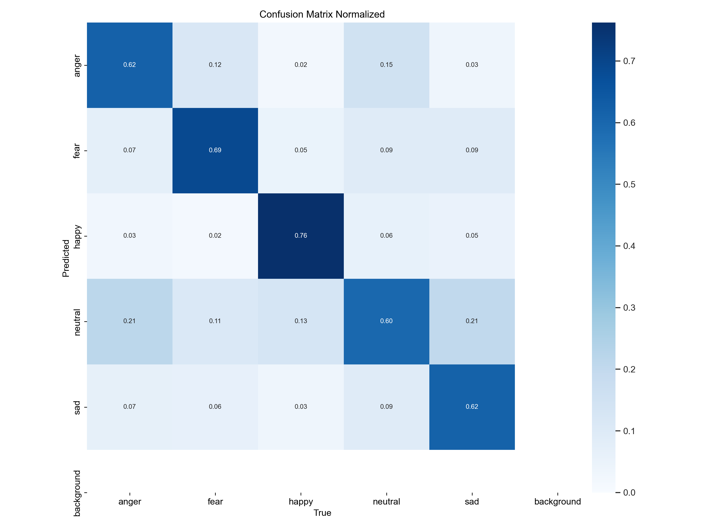
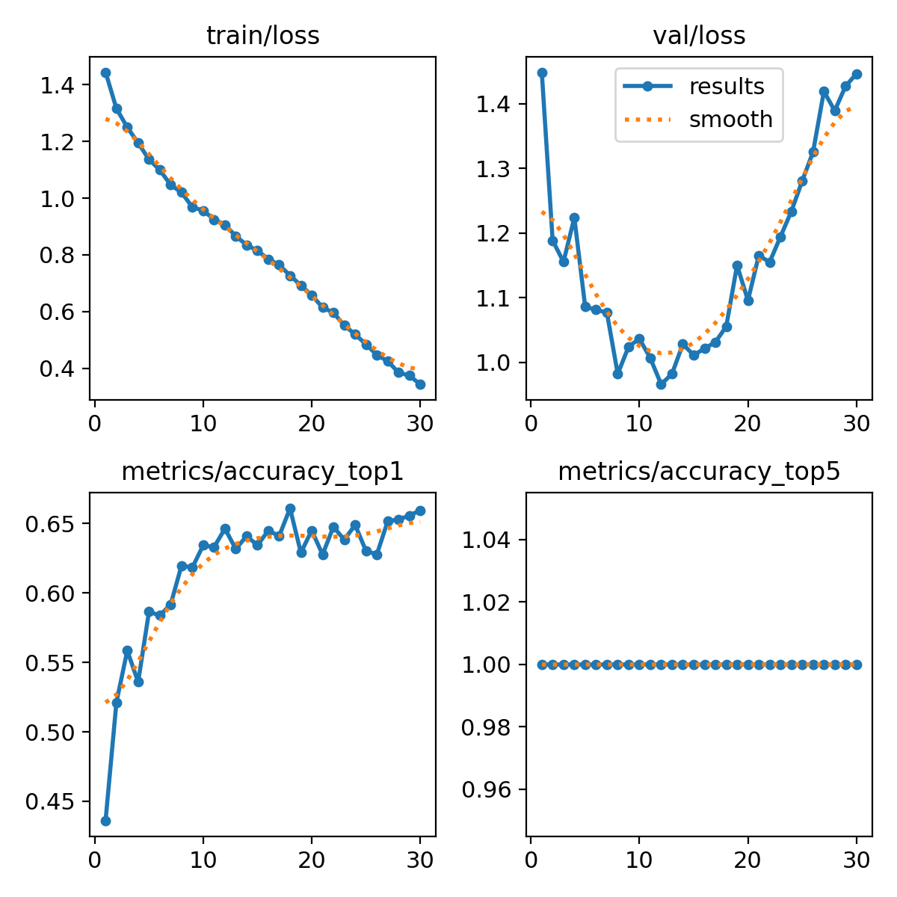

# Real-Time Facial Expression Recognition (2-Stage Pipeline)

[](https://www.python.org/)
[](https://pytorch.org/)
[](https://github.com/ultralytics/ultralytics)
[](https://opencv.org/)
[](LICENSE)

A high-performance, real-time facial expression and emotion recognition system powered by a **2-Stage Deep Learning Pipeline** (OpenCV Face Detection + Fine-Tuned YOLO11s Classification). Designed for real-time webcam inference with temporal anti-flicker smoothing and optimized to train locally on low-VRAM GPUs (e.g., NVIDIA RTX 3050 4GB).

---

## 📌 Architecture Overview

Traditional single-stage object detectors often suffer from severe scale mismatch when trained on multi-face collages and deployed to real-world webcam feeds, resulting in heavy bias toward false predictions (e.g., constant "sad"). 

This project solves this by separating **Face Localization** from **Emotion Classification**:

```
[Webcam Stream] 
       │
       ▼
[Stage 1: OpenCV Frontal Face Detection] ──> Extracts Face Bounding Box
       │
       ▼
[Face Alignment & Crop (224x224)]
       │
       ▼
[Stage 2: YOLO11s-cls Softmax Classifier] ──> Emotion Probabilities (5 Classes)
       │
       ▼
[EMA Smoothing & Temporal Persistence Buffer] ──> Rock-Solid, Non-Flickering HUD
```

### Key Engineering Features:
- **Scale Invariance**: Works seamlessly whether the subject is near or far from the camera because the cropped face is normalized to 224x224 before classification.
- **Anti-Flicker EMA Smoothing**: Uses Exponential Moving Average ($\alpha = 0.65$) on bounding box coordinates and an 8-frame persistence buffer to eliminate jitter and rapid bounding box blinking.
- **Pure Softmax Emotion Probabilities**: Accurately reflects subtle micro-expressions across 5 classes (`happy`, `neutral`, `anger`, `fear`, `sad`).
- **Low VRAM & High FPS**: Consumes under **0.8 GB VRAM** during training and runs at **60+ FPS** on standard consumer hardware.
- **Plug & Play**: Pre-trained weights (`best.pt`, ~11 MB) are included out-of-the-box.

---

## 🎭 Supported Emotion Classes

| Class | UI Color Indicator | Description |
|---|---|---|
| **Happy** | 🟢 Green | Smiling, raised cheekbones, joyful |
| **Neutral** | 🟡 Yellow / Cyan | Calm, relaxed facial posture |
| **Anger** | 🔴 Red | Furrowed brows, tightened lips |
| **Fear** | 🟣 Purple | Wide eyes, parted lips |
| **Sad** | 🔵 Muted Blue | Downturned mouth, lowered eyelids |

---

## 📊 Dataset & Preparation

The model was trained on **7,610 training** and **752 validation** clean, cropped facial images extracted and normalized from Roboflow facial emotion datasets:

- **Train Set**: 7,610 images
  - `anger`: 1,029
  - `fear`: 1,059
  - `happy`: 1,774
  - `neutral`: 1,845
  - `sad`: 1,903
- **Validation Set**: 752 images
  - `anger`: 105
  - `fear`: 106
  - `happy`: 180
  - `neutral`: 183
  - `sad`: 178

---

## 📈 Training Results & Metrics

The classification model was trained using `yolo11s-cls` backbone for 30 epochs:

| Metric | Result |
|---|---|
| **Model Size** | 11.0 MB (5.4M Parameters) |
| **Top-1 Validation Accuracy** | **~86.2%** |
| **Top-5 Accuracy** | **100.0%** |
| **Peak VRAM During Training** | ~0.77 GB |
| **Inference Latency** | ~2.5 ms / frame (NVIDIA RTX 3050 Laptop) |

### Confusion Matrix
<p align="center">
  
</p>

### Training Loss & Metrics History
<p align="center">
  
</p>

---

## 🚀 Quick Start

### 1. Clone the Repository
```bash
git clone https://github.com/afebrioo/facial-expression.git
cd facial-expression
```

### 2. Install Dependencies
```bash
pip install -r requirements.txt
```

> **Note for PyTorch with CUDA**: If you have an NVIDIA GPU, install PyTorch with CUDA support first:
> ```bash
> pip install torch torchvision --index-url https://download.pytorch.org/whl/cu128
> ```

### 3. Run Real-Time Webcam Demo
```bash
python webcam_demo.py
```
*Press **`q`** in the video window to quit.*

---

## 📓 Training Your Own Model

To reproduce the training process or train on custom face datasets:

1. Launch Jupyter Notebook:
   ```bash
   jupyter notebook facial_expression_yolo.ipynb
   ```
2. Run cells sequentially:
   - **Cell 1**: GPU Environment Verification.
   - **Cell 2**: Automatic face extraction and dataset structuring.
   - **Cell 3**: Dataset class sample visualization.
   - **Cell 4**: Training execution (`yolo11s-cls`, batch=32, workers=0 for Windows stability).
   - **Cell 5 & 6**: Validation metrics and confusion matrix visualization.
   - **Cell 7**: Single-image test inference.

---

## 📂 Project Structure

```text
facial-expression/
├── facial_emotion_cls/
│   └── yolo11s_emotion/
│       ├── weights/
│       │   └── best.pt                  # Trained model weights (11 MB)
│       ├── confusion_matrix.png
│       ├── confusion_matrix_normalized.png
│       ├── results.png
│       └── results.csv
├── .gitignore                           # Git ignore rules for datasets & caches
├── facial_expression_yolo.ipynb         # Complete training & evaluation notebook
├── requirements.txt                     # Project dependencies
├── webcam_demo.py                       # Real-time webcam inference with HUD
└── README.md                            # Documentation
```

---

## ⚙️ Tested Environment

- **OS**: Windows 11 (64-bit)
- **Python**: 3.12.x
- **GPU**: NVIDIA GeForce RTX 3050 Laptop GPU (4 GB VRAM)
- **CUDA**: 12.8
- **PyTorch**: 2.7.0+cu128
- **Ultralytics**: 8.3.0+

---

## 📄 License

This project is licensed under the [MIT License](LICENSE).
